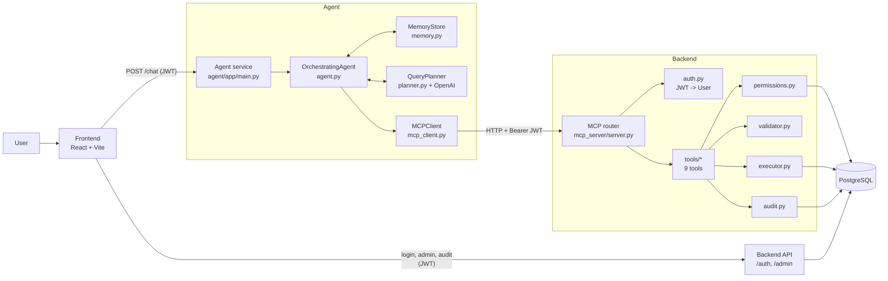

# MCP Secure AI DB

A natural-language interface to a PostgreSQL database where an LLM plans the SQL, but every query passes through a permission-aware tool server that validates, limits, and audits it. Built for teams that want to give non-technical users chat access to data without handing an LLM raw database credentials.

## Why

Letting an LLM write SQL against a real database is risky: it can read columns it should not see, return unbounded result sets, or run an `UPDATE` without a `WHERE`. This project puts a governed tool layer between the model and the database, so the model only ever proposes SQL and the server decides what actually runs.

## Key features

- **Chat-to-SQL agent** (FastAPI + OpenAI `gpt-4o`): turns a message into a JSON plan of tool calls, using the live schema, the user's permissions, and per-user conversation memory.
- **MCP-style tool server** exposing nine tools over HTTP, with a catalog at `GET /mcp/tools`:
  `get_schema`, `get_user_permissions`, `validate_query`, `dry_run_query`, `run_read_query`, `run_write_query`, `explain_query`, `estimate_query_cost`, `audit_query_history`.
- **Table- and column-level permissions** stored per user in `user_permissions` (`can_read`, `can_write`, `allowed_columns`), re-checked server-side on every tool call.
- **Enforced write path**: writes must go `validate_query` -> `dry_run_query` -> `run_write_query`.
- **Audit log** of every read and write (user, operation, table, SQL, success/failure) in `mcp_audit_logs`.
- **JWT auth** with access and refresh tokens, `admin` and `user` roles.
- **React admin console** to manage users' table/column permissions and browse audit logs; a chat page for regular users that renders results as tables.

## Architecture



## How a request flows

1. The user logs in through the frontend; the backend issues a JWT access token and refresh token.
2. The chat page sends `POST /chat` to the agent service with the message and the user's JWT.
3. The agent loads conversation memory for that user and calls `get_schema` and `get_user_permissions` on the tool server.
4. `QueryPlanner` sends the message, schema, permissions, and memory to OpenAI and gets back a JSON plan (`intent` + `actions`). The plan is checked locally: allowed intents and tools only, no `DROP`/`TRUNCATE`/`ALTER`, `LIMIT` required on non-aggregate reads, and `SELECT *` rewritten to the user's allowed columns.
5. The agent executes each action through `MCPClient`, forwarding the user's JWT. Reads are a single `run_read_query`; writes are exactly `validate_query`, `dry_run_query`, `run_write_query`.
6. On the server, each tool resolves the user from the JWT, loads their permissions, and re-runs the validator before touching the database.
7. Reads and writes are executed, logged to `mcp_audit_logs`, and returned. The agent updates memory and replies with a short summary plus the result rows.

## Safety model

The agent-side checks are a convenience; the server does not trust the plan. Every SQL-taking tool calls `validator.validate_query` with the caller's permissions.

**Validator (`backend/app/mcp_server/validator.py`)**
- Rejects any statement containing `DROP`, `TRUNCATE`, or `ALTER`, and the tautology `OR 1=1`.
- Only `SELECT`, `INSERT`, `UPDATE`, `DELETE` are accepted.
- Reads must match a simple single-table `SELECT ... FROM t [WHERE] [ORDER BY] [LIMIT]` pattern; the table must exist.
- Non-aggregate reads: every requested column must be in the user's `allowed_columns`, otherwise `403`.
- Result size is capped at 200 rows (default 200, any larger `LIMIT` is lowered).
- Writes: the target table is extracted from `UPDATE` / `INSERT INTO` / `DELETE FROM` and must exist; `UPDATE` and `DELETE` without `WHERE` are rejected.

**Permissions (`permissions.py`)**: no row for the table means no access; `can_read` / `can_write` gate the operation; `allowed_columns = null` means all columns.

**Executor (`executor.py`)**: rewrites the read's select list to the permitted columns and applies the enforced `LIMIT` before execution.

**Dry run**: `dry_run_query` validates the statement and runs `EXPLAIN` on it (no `ANALYZE`, so nothing is executed), returning the plan. `estimate_query_cost` uses `EXPLAIN (FORMAT JSON)` to return startup cost, total cost, and estimated rows.

**Audit**: `run_read_query` and `run_write_query` record success or failure. `audit_query_history` returns all users' history to admins and only the caller's own history to regular users.

## Tech stack

| Layer | Stack |
| --- | --- |
| Agent | Python, FastAPI, Uvicorn, OpenAI SDK, httpx, Pydantic / pydantic-settings |
| Backend | Python, FastAPI, SQLAlchemy, Alembic, psycopg2, PyJWT, passlib[bcrypt] |
| Database | PostgreSQL (JSONB for column permissions) |
| Frontend | React 19, Vite 7, Tailwind CSS 4, React Router 7, Axios, Framer Motion, lucide-react |

## Project structure

```
mcp-secure-ai-db/
├── agent/
│   ├── app/            # main.py, agent.py, planner.py, mcp_client.py, memory.py
│   └── requirements.txt
├── backend/
│   ├── alembic/        # migrations
│   ├── app/            # api/, core/, db/ (models, seed), mcp_server/ (tools, validator, permissions, audit)
│   └── requirements.txt
└── frontend/
    ├── src/            # api/, auth/, components/, layouts/, pages/ (chat, admin, login)
    └── package.json
```

## Run locally

Prerequisites: Python 3.10+, Node 18+, a PostgreSQL database, an OpenAI API key.

**1. Backend (tool server + auth/admin API)**

Create `backend/.env` with `DATABASE_URL` and `JWT_SECRET_KEY`.

```bash
cd backend
python -m venv .venv && source .venv/bin/activate
pip install -r requirements.txt pydantic-settings
alembic upgrade head
python -m app.db.seed        # wipes and reseeds demo users, permissions, candidates, interviews
uvicorn app.main:app --port 8000
```

The seed creates an `admin` and a restricted `user` account (see `backend/app/db/seed.py`) with sample `candidates`, `interviewers`, and `interviews` data.

**2. Agent**

Create `agent/.env` with `MCP_BASE_URL` (the backend URL, e.g. `http://localhost:8000`) and `OPENAI_API_KEY`.

```bash
cd agent
python -m venv .venv && source .venv/bin/activate
pip install -r requirements.txt
uvicorn app.main:app --port 8001
```

**3. Frontend**

Create `frontend/.env` with `VITE_BACKEND_API_URL` and `VITE_AGENT_API_URL`.

```bash
cd frontend
npm install
npm run dev                  # http://localhost:5173 (allowed by backend CORS)
```

## Possible next steps

- Replace the regex-based SQL checks with a real parser (for example sqlglot) so joins are supported and column permissions also apply to `WHERE` clauses and aggregate queries, which currently skip the column check.
- Add an automated test suite for the validator and permission rules; the repo has no tests yet.
- Serve the tools over the MCP protocol itself (the `mcp` package is already in `backend/requirements.txt` but unused) so any MCP client can connect, not only the bundled agent.
